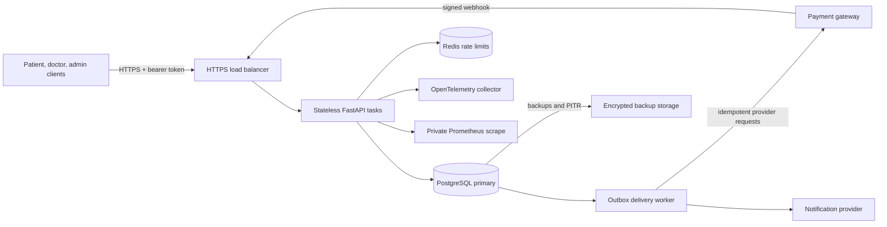
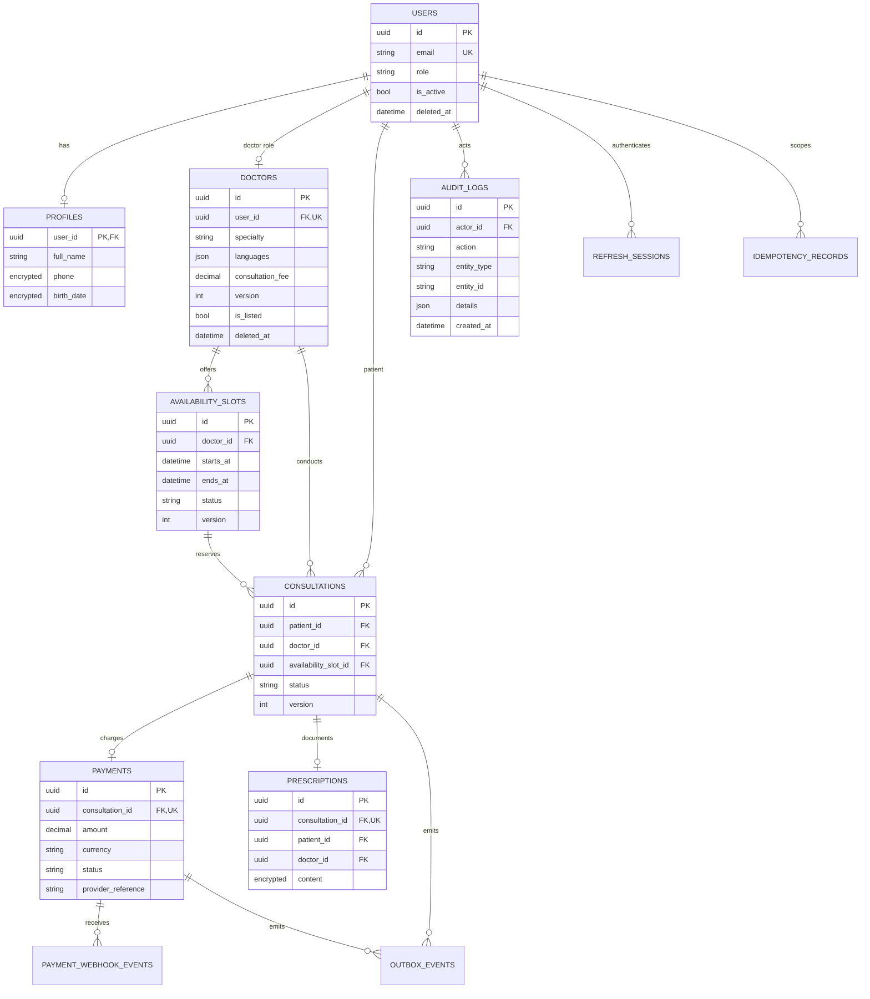

# Amrutam telemedicine backend architecture

## Scope and target

This repository implements a REST API as a modular monolith using FastAPI,
SQLAlchemy, Alembic, and PostgreSQL. The application tier is stateless and can
scale horizontally. PostgreSQL owns durable business state and booking
correctness; Redis is used for shared rate limiting. A transactional outbox
provides the boundary for payment-provider, refund, and notification work.

The design target is 100,000 consultations/day (about 1.16 bookings/second on
average, with peak load requiring separate capacity testing), read p95 below
200 ms, write p95 below 500 ms, and 99.95% availability. These are service
objectives, not measured results or guarantees: the repository does not include
production load-test results, a payment provider, or an operating on-call
service. Capacity, database connection limits, autoscaling, and recovery targets
must be verified in the intended region with representative workloads.

## Components and data flow



The current AWS Terraform files provision an ECS/Fargate API service, an HTTPS
ALB, Multi-AZ RDS PostgreSQL, encrypted/failover-enabled ElastiCache Redis,
Secrets Manager, ECR, CloudWatch logs, and CPU-based task scaling. The outbox
processor and concrete external payment/notification adapters are application
integration work: they are not deployed by that Terraform stack yet. In
particular, do not enable real payment collection until provider credentials,
idempotent adapter behavior, webhook configuration, reconciliation, and refund
operations have been implemented and tested.

## Booking sequence and failure handling

```mermaid
sequenceDiagram
    participant A as Patient
    participant API as API task
    participant DB as PostgreSQL
    participant W as Outbox consumer
    participant G as Payment gateway

    A->>API: POST /v1/consultations + Idempotency-Key
    API->>DB: Claim key, lock slot, validate doctor/time
    API->>DB: Conditional slot update + consultation + payment + audit + outbox
    DB-->>API: Commit one transaction
    API-->>A: 201 pending_payment
    W->>DB: Claim outbox event with lease
    W->>G: Create payment intent using outbox event ID as idempotency key
    G-->>A: Hosted checkout
    G->>API: Signed payment webhook (at-least-once)
    API->>DB: Verify signature/window, dedupe event, update payment and booking
    API->>DB: Audit transition and enqueue notification/refund
    DB-->>API: Commit
    API-->>G: 200 accepted

    par Same slot raced by another patient
        A->>API: Booking request with a different key
        API->>DB: Conditional update and active-booking uniqueness
        DB-->>API: 409; no second active consultation
    and Provider succeeds after booking was cancelled/released
        G->>API: Late success
        API->>DB: Record payment; queue refund; do not reclaim slot
    and Gateway times out after creating intent
        W->>G: Retry with the same stable event ID
        G-->>W: Existing intent, not a duplicate charge
    end
```

The write path is intentionally short. Slot availability is determined by a
database conditional update, version comparison, row lock, and a partial unique
index over active consultations; an application-side read alone is not
authoritative. PostgreSQL transactions bind the slot reservation, consultation,
payment record, immutable audit entry, and outbox event. A duplicate idempotency
key replays the saved response; reuse with a different request body conflicts.
Verified payment webhooks are deduplicated by provider event ID and checked
against the stored amount and currency. Provider calls and notifications occur
outside that transaction and must be retried with capped exponential backoff
and jitter. Outbox delivery is at-least-once, so consumers use the stable event
ID as their provider idempotency key.

The server clock is authoritative for slot start and webhook freshness checks;
clients do not choose booking time. Synchronize hosts with a managed time
service, alert on clock offset, use UTC timestamps, and retain a bounded webhook
clock-skew window. A doctor becoming inactive during payment confirmation
prevents confirmation; a successful late charge is recorded and a refund is
queued rather than resurrecting a booking.

## Data model



Additional reliability tables include idempotency records, refresh-token
sessions, payment webhook event deduplication, and outbox events. Database
constraints and indexes are defined in SQLAlchemy metadata and Alembic
migrations; production must deploy schema changes with a separate migration
identity.

## Scaling, consistency, and operations

Popular directory reads use indexed PostgreSQL queries and avoid loading
inactive, unlisted, or soft-deleted doctors. Redis is not used as the source of
truth for a slot lock. Add a cache only after measuring query pressure, with
short TTLs and explicit invalidation for directory updates; never cache patient
records, prescriptions, or booking availability as authoritative.

At 100k consultations/day, the initial primary is deliberately unsharded.
Measure row growth, query plans, vacuum, index size, backup duration, and
retention first. Introduce monthly UTC partitions for consultation/payment and
high-volume event data using an expand/backfill/dual-write/cutover plan, retaining
global idempotency registries and immutable audit archives. Read replicas are
appropriate for stale-tolerant search and analytics, not booking decisions or
immediate post-write reads. Shard only after measured primary saturation or a
data-residency boundary, keeping one patient's booking and payment workflow in
one shard.

RDS is configured Multi-AZ with 14-day backups and deletion protection. Validate
point-in-time recovery and region restore through scheduled exercises; set
explicit RPO/RTO objectives with product and compliance owners. Terraform state
contains generated credentials and must use a versioned, encrypted, access-
restricted remote backend. Application secrets are delivered from Secrets
Manager, never baked into images. Logs, metrics, traces, and backup archives
must have least-privilege access, retention controls, and PHI-safe labels.

For detailed endpoint behavior, see the generated
[OpenAPI schema](./openapi.json), the [booking/payment notes](./booking-and-payments.md),
and the [deployment guide](./deployment.md). Search and analytics are read
paths; they must be load-tested separately from the transactional booking path.
